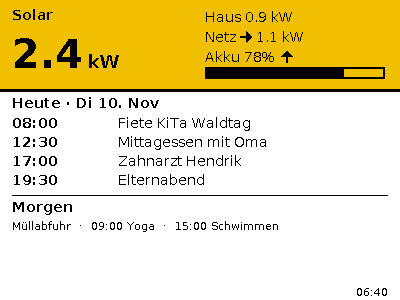

# eink-kitchen-panel

Firmware for a battery-powered e-paper panel on the kitchen counter (ZECTRIX
NOTE4C, ESP32-S3, 4.2" black/white/yellow/red). It shows the family calendar
for today and tomorrow plus live solar readings, refreshes every 15 minutes
between 06:00 and 22:00 and sleeps otherwise. Data comes from
[home-apis](https://github.com/githendrik/home-apis).



## Using the panel

| Button | Does |
|---|---|
| Side, lower (Down) | Short press: refresh now. Hold 3 s: switch off ("Aus"). When off: switch on. |
| Front, round | Maintenance screen (IP, version, battery, update check). Press again to leave. |
| Side, upper (Up) | On the maintenance screen: install the offered update (green LED blinks). |

First setup: the panel opens WiFi `Kuechenpanel-Setup`; join it and enter
WiFi, backend URL and token.

## Develop

```sh
pio test -e native   # host unit tests
pio run -e note4c    # build firmware
```

Start with [AGENTS.md](AGENTS.md) → [docs/status.md](docs/status.md),
[docs/decisions.md](docs/decisions.md), [docs/architecture.md](docs/architecture.md),
[docs/release.md](docs/release.md).
