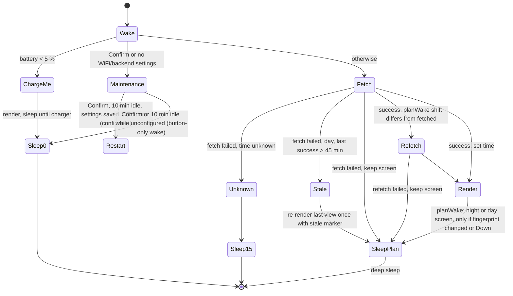
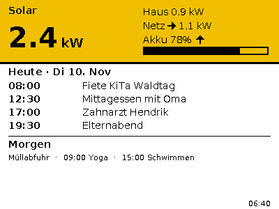
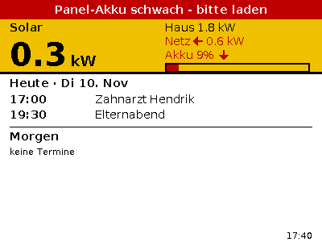
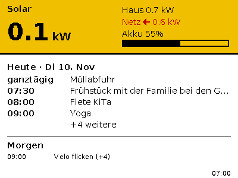
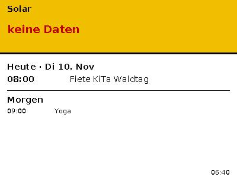
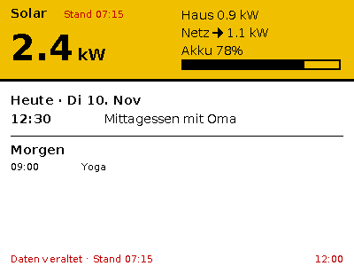
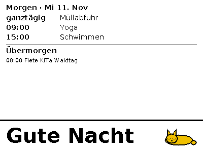
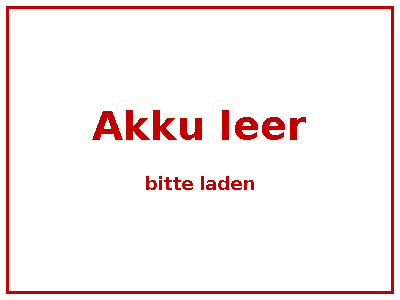
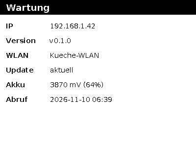

# Architecture

Firmware for the ZECTRIX NOTE4C (ESP32-S3 N16R8, 400×300 4-colour e-paper) kitchen panel.

## Layout

- `src/main.cpp` – Arduino entry point; runs `runWakeCycle()` (test pattern only in `note4c-diag`).
- `src/app.*`, `src/net.*`, `src/settings.*`, `src/maintenance.*` – wake cycle, WiFi/HTTP, NVS settings, maintenance mode; `src/ota.*` – GitHub release check and OTA install.
- `src/board.*`, `src/epd_ssd2683.*` – power, buttons, battery, display driver.
- `lib/core` – plain C++17, no Arduino headers; builds for `native` and `note4c`.
- `test/` – Unity tests, run with `pio test -e native`.

## Pins

| Function | GPIO |
|---|---|
| Power latch (HIGH + `gpio_hold_en`) | 17 |
| EPD power | 6 |
| EPD SCK / MOSI | 12 / 13 |
| EPD CS / DC / RST | 11 / 10 / 9 |
| EPD BUSY (low = busy) | 8 |
| Button Confirm (active low, RTC) | 0 |
| Button Down (active low, RTC) | 18 |
| Button Up (active low, not RTC) | 39 |
| CHRG_L (low = charging) | 2 |
| STDBY_H | 1 |
| Battery ADC (ADC1_CH3, 12 dB, ×2 divider) | 4 |
| LED (active low) | 3 |
| Audio power / amp (kept off) | 42 / 46 |

## Display

400×300, 2 bits per pixel, MSB first, 100 bytes/row, 30 000-byte buffer.

| Colour | Code |
|---|---|
| BLACK | 0 |
| WHITE | 1 |
| YELLOW | 2 |
| RED | 3 |

## Board and power (`src/board.cpp`)

- `board::begin()` drives GPIO17 HIGH and `gpio_hold_en`s it, keeps EPD power (6), LED (3, high = off), audio power (42) and amp (46) off, and enables pull-ups on buttons and CHRG_L.
- `deepSleep(seconds, wakeOnCharger)`: EPD power low and held, latch held through deep sleep with `gpio_deep_sleep_hold_en()` (so the board stays powered on battery), ext1 `ANY_LOW` wake on GPIO0|GPIO18 (+GPIO2 when `wakeOnCharger`), RTC pull-ups on those pins, optional timer wake (`seconds <= 0` = none).
- Wake mapping: undefined → PowerOn, timer → Timer, ext1 mask bit 0 → ButtonConfirm, bit 18 → ButtonDown, bit 2 → Charger, else Other. Up (GPIO39) is not an RTC pin: it can only be polled while awake.
- `powerOff()` ("Aus"/standby): waits for Down to be released, then sleeps like `deepSleep(0, false)` but drives the latch (GPIO17) LOW. On battery the board switches off completely; pressing Down/Power powers it on again (wake cause PowerOn, normal cycle). On USB the chip stays powered and sleeps with button-only wake (Down → refresh, Confirm → maintenance).

### Switching off ("Aus")

Hold the side Down button for 3 s (`kOffHoldMs`): after a ButtonDown wake, `downHeldFor(3000)` polls GPIO18; if it stays low, `decideWake` returns `Off` (before every other rule, including the charge screen), the "Aus – zum Einschalten seitliche Taste unten drücken" screen is drawn (`docs/screens/off.png`, no yellow/red so it never looks like live data) and `powerOff()` runs. A short press is still "refresh now". Use it before the solar system exists or for holidays: no timed wakes, no redraws.
- Battery: ADC1_CH3, 12 dB, `esp_adc_cal` (eFuse calibration; Arduino-ESP32 2.x/IDF 4.4 has no curve-fitting scheme), ×2 divider, mean of 10 reads.

## SSD2683 driver (`src/epd_ssd2683.cpp`)

`Epd::show(buf)` runs: GPIO6 high → SPI3 at 10 MHz mode 0 with manual CS → RST high/low (20 ms)/high → wait BUSY → `0xE9 0x01` → `0x10` + 300 rows of 100 bytes → `0x04`, wait BUSY → `0x12 0x00`, wait BUSY → `0x02 0x00`, wait BUSY → `0x07 0xA5` (deep sleep) → SPI released, GPIO6 low and held. BUSY low = busy, timeout 120 s (logged, then continues).

`note4c-diag` (`-DDIAG_TEST_PATTERN`) draws four bars (black/white/red/yellow) plus "Ä Ö Ü ß Test", logs wake cause, battery, charging, and sleeps 120 s.

### Hardware verification

- Diag build (`note4c-diag`) flashed on device MAC `84:c7:bb:4d:be:ac` on 2026-11-10.
- After a 120 s deep sleep on USB power the serial log showed `wake=Timer battery=4140 mV (99%) charging=0`.
- The display sequence completed without a busy timeout.
- 2026-11-11 (user at the device, v0.1.x): kitchen screen renders with real calendar + fake solar; Confirm wakes into maintenance, Down wakes and refreshes; OTA install via maintenance + Up works (v0.1.1 → v0.1.2 → …); hold Down 3 s on battery shows "Aus" and switches off, short Down press powers back on into the normal cycle.
- Still open: colour/umlaut legibility judged by eye over time, long-term battery drain per day.

## Wake cycle (`src/app.cpp`)

`setup()` calls `board::begin()` then `runWakeCycle()` (except in `note4c-diag`). TZ is set to `CET-1CEST,M3.5.0,M10.5.0/3` at the start of each wake. Time comes from the RTC (`time()` > 2023-11 counts as known); after any successful fetch `settimeofday` is set from `server_time`.

Pure decisions live in `lib/core/src/wake.h` (`decideWake`, `planWake`, `dayPlanTooShort`; tests in `test/test_wake`). `planWake(now, tz, down)` returns `{renderNight, shift, sleepSeconds}` and is used by both the success and the failure path.

- Day: fetch `shift=0`, redraw only when `fingerprint(View)` changed (or Down pressed), sleep `planAfterDayRefresh`. If that sleep would be < 60 s, the night screen is rendered now (`shift=1`) and the panel sleeps until 06:00.
- Night timer wake: fetch with the `planNight` shift, render night screen, sleep until 06:00. If that night sleep would be < 60 s (clock drift just before 06:00) it is treated as day: live day screen, `shift=0`, sleep until just after 06:00. Down at night: live day screen, sleep 10 min; the next timer wake in the night phase renders night again.
- If the refetch for a different shift fails, the screen is kept (no night screen from shift-0 data). `rtcBody` holds the body that was actually rendered. Response bodies over 16 KB are rejected.
- Unconfigured device (no stored WiFi credentials or no `url`/`token`): maintenance only on Confirm/PowerOn, then deep sleep with no timer. See "Maintenance mode".
- The first successful WiFi connect of a normal wake cycle (or maintenance) calls `esp_ota_mark_app_valid_cancel_rollback()`; `verifyRollbackLater()` is overridden so Arduino does not validate earlier. A bad OTA image that never gets that far reverts. An image that connects but is otherwise broken is not rolled back and must be reflashed via USB (`docs/release.md`).
- `server_time` below 2026-01-01T00:00:00Z (`serverTimePlausible`, includes missing/unparseable = 0) is never applied. If the RTC time is already known it is kept and the cycle proceeds; otherwise it counts as a failed fetch (sleep 15 min).
- ChargeMe (battery < 5 %): `planChargeMe` draws the screen only if the RTC flag `rtcChargeMeShown` is not set. While charging (or after a Charger wake) CHRG_L stays low, so the device sleeps 15 min on a timer without the charger wake bit; otherwise it sleeps until the charger is connected. At ≥ 5 % the normal cycle resumes and the fingerprint is cleared so the ChargeMe screen is redrawn over.
- Sleep: LED (high), audio power and amp (low) are held with EPD power and latch. `hasWifiCreds()` turns the radio off again, and is skipped on the ChargeMe path.
- RTC drift can wake the panel a little early in the night phase; the fingerprint check prevents a redraw. If a night fetch fails the day screen stays until 06:00.
- Release builds do not wait for the serial banner; `-DDEBUG` adds a 500 ms delay.
- Stale: the last raw `/kitchen` body is kept in RTC slow memory when ≤ 4000 bytes (`rtcBody`). If a fetch fails and the last success is > 45 min old, it is re-rendered once with the stale marker; larger bodies skip this.
- Settings: NVS namespace `kitchen`, keys `url`, `token` (`Preferences`); WiFi uses the stored station credentials via `WiFi.begin()`, 15 s timeout, WiFi off before sleep. HTTPS uses `setInsecure()` (no certificate pinning).
- RTC state: fingerprint, last success time, stale-shown flag, last body.

## Maintenance mode (`src/maintenance.cpp`, `src/ota.cpp`)

Entered on Confirm wake, or on first boot / unconfigured device (no WiFi credentials or empty `url`/`token`). Timer/other wakes in the unconfigured state go straight back to button-only sleep.

- NVS namespace `kitchen`: `url` (backend base URL), `token` (bearer token). WiFi credentials are WiFiManager/ESP station credentials.
- The screen is drawn at most twice: on entry (IP `-`) and once when the IP and update check are known; a failed OTA install adds a third, final redraw ("Update fehlgeschlagen").
- Idle timeout is a true 10 min: button presses, OTA attempts and any HTTP request served by the portal (`_webPortalAccessed`, read through a `WiFiManager` subclass) reset it.
- A configured device that cannot join WiFi falls back to the `Kuechenpanel-Setup` config portal, so WiFi can be reconfigured without USB.
- Rollback: the Arduino-ESP32 prebuilt bootloader has `CONFIG_BOOTLOADER_APP_ROLLBACK_ENABLE=y` (verified in the core's `tools/sdk/esp32s3/sdkconfig`), so a new OTA image is pending-verify. `initArduino()` would mark it valid before `setup()`, so `src/main.cpp` overrides the weak `verifyRollbackLater()` to return true; validation is then done explicitly by `esp_ota_mark_app_valid_cancel_rollback()` right after WiFi connects on a normal wake or in maintenance. An image that crashes or cannot connect before that reverts to the previous one on reset.
- Unconfigured: WiFiManager non-blocking config portal, AP `Kuechenpanel-Setup`, params "Backend URL" (default `http://home-apis:3000`) and "Token", 10 min portal timeout. On save, settings are stored and the device restarts. Idle/Confirm exit goes to button-only deep sleep (no restart, to avoid re-entering maintenance in a loop).
- Configured: WiFi connects, `startWebPortal()` serves the same parameters at `http://<ip>/`.
- Update check: GitHub API `releases/latest` of `githendrik/eink-kitchen-panel`; asset must be named exactly `firmware.bin`; available when `tag_name != FIRMWARE_VERSION`. Shown as "Update <tag> verfügbar - Taste Hoch" (umlauts and "…" are in the font; arrows and the en dash are not, hence the plain hyphen; fits 400 px for tags like v0.10.12, see `docs/screens/maintenance_update.png`). TLS uses `setInsecure()` (no CA store; public data).
- Buttons while awake: GPIO0 Confirm = exit (the wake press must be released first), GPIO39 Up = install update (streams into the OTA partition, then `esp_restart()`; the green LED lights immediately and blinks during the download — the e-paper is too slow for feedback — and goes off if the update fails). Both debounced by polling.
- Exit: Confirm or 10 min idle → `esp_restart()` (wake cause PowerOn; the normal wake cycle runs since settings are complete) when configured; an unconfigured device goes to button-only deep sleep instead (see above).
- Releases: see `docs/release.md`.

## Rendering (`lib/core`)

- `Canvas` (`canvas.h`) wraps a caller-owned 30 000-byte buffer; all drawing is clipped.
- `drawText`/`textWidth` (`text.h`) decode UTF-8 to Latin-1 code points; U+2026 "…" maps to code 0x7F, anything else unknown becomes `?`. Text longer than `maxW` is truncated with "…".
- Fonts (`lib/core/src/fonts/`) are generated Adafruit-GFX style `const` headers from DejaVu Sans / Bold (1-bit, no antialiasing): Small 11, Body 14, BodyBold 14 bold, Title 18 bold, Huge 40 bold px. Covers 0x20–0x7E, 0xA0–0xFF and "…".
- Regenerate: `python3 -m venv venv && venv/bin/pip install pillow && venv/bin/python tools/gen_fonts.py`. TTFs and licence are in `tools/fonts/`.

## Data model and schedule (`lib/core`)

- `kitchen.h`: `parseKitchen` turns the `/kitchen` JSON into `Kitchen` (`today`, `tomorrow`, optional `solar`, `serverTimeUtc`). Invalid JSON or missing `calendar.today`/`tomorrow` returns false with `err` set. `solar: null` gives no `Solar`. A solar `updated_at` that fails to parse is treated as stale. `parseIsoUtc` handles `Z`/`±HH:MM` offsets with its own days-from-civil (no `timegm`).
- `battery.h`: `batteryPercent(mV) = (-v² + 9016v − 19189000)/10000`, clamped 0–100.
- `schedule.h`: local time via `setenv("TZ")`/`tzset`/`localtime_r`/`mktime` with a POSIX TZ string (`CET-1CEST,M3.5.0,M10.5.0/3`).
  - Day phase is 06:00–22:00 local (`phaseAt`).
  - `planAfterDayRefresh`: sleep `min(900 s, time to 22:00)`, shift 0; outside the day window it defers to `planNight`.
  - `planNight`: sleep until the next 06:00 local (DST-aware); `shift=1` from 22:00 to midnight, `0` after midnight.

## View model (`lib/core/src/view.h`)

`buildDayView` / `buildNightView` turn `Kitchen` into a render-ready `View` (German UTF-8 text, arrows kept; the renderer maps unsupported glyphs). Powers are shown in kW with one decimal (half away from zero). `headerDate` uses `today.date` ("Di 10. Nov"). Labels are "Heute"/"Morgen"; if `today.date` differs from the local date of `now` (night view, shift=1) they are "Morgen"/"Übermorgen". All-day events are listed first ("ganztägig"), then timed ones ("HH:MM").

| Warning (red) | Condition |
|---|---|
| `warnGridImport` | `grid_w > 50` (≤ 50 is no warning) |
| `warnHomeBatteryLow` | home battery SoC < 15 % |
| `warnPanelBattery` | panel battery < 20 % |
| `solarStale` | backend `stale` or `updated_at` > 30 min before now (shows "Stand HH:MM") |
| `solarMissing` | `solar` is null |
| `dataStale` | `lastSuccessUtc` > 45 min before now; `lastSuccessUtc == 0` ("never") is not stale; never set in the night view |

Battery arrow: `battery_w ≥ 50` "↑", `≤ −50` "↓", otherwise none.

`fingerprint` is FNV-1a over: screen, header date, PV/load/grid rounded to 100 W, grid direction, SoC in 5 % steps (floor), arrow, all warning flags, labels and all event times/titles. It excludes `updatedAt` and clock times, so a refresh only redraws on visible change.

## Screens (`lib/core/src/render.h`)

- `renderDay`: yellow solar banner (92 px, 3 px black bottom border): "Solar", Huge kW number, house/grid/battery (arrows drawn as shapes, since the fonts lack "→←↑↓") and a SoC bar. Below (10 px gap): today header, up to 5 event lines (Body, 19 px pitch), a divider with 14 px air above and below, then tomorrow one event per line (Small, 15 px pitch, time column + title) as far as space allows above the footer (last baseline 282); overflow ends with "+N weitere", or "(+N)" appended to the only line when just one fits. Update time bottom-right. With `warnPanelBattery` a 24 px red bar ("Panel-Akku schwach - bitte laden", ASCII hyphen because the font lacks an en dash) sits on top and the banner shrinks to 68 px. Red text: grid import, home battery < 15 %, stale solar "Stand", stale data footer. Missing solar shows "keine Daten" in the banner.
- Overflow: more than 5 events today → 4 events plus "+N weitere" (`visibleTodayLines` returns 4).
- `renderNight`: calendar (shifted labels) plus a top "Gute Nacht" banner (yellow, same 92 px / 68 px compact geometry as the day banner, red warning bar above when the panel battery is low) with a sleeping cat (`cat_bitmap.h`, drawn with primitives, white body with black outline). `renderChargeMe`: red frame and "Akku leer / bitte laden". `renderMaintenance`: IP, version, WLAN, update, battery, last fetch.
- Simulator: `pio run -e sim && .pio/build/sim/program tools/sim/scenarios docs/screens` renders each scenario JSON (`screen`, `now`, `panelBatteryPct`, `lastSuccess`, `kitchen` body, `maint`) to a PNG with a built-in encoder.

| | |
|---|---|
|  |  |
|  |  |
|  |  |
|  |  |

## Environments

- `sim` – host PNG simulator (`tools/sim`).
- `note4c` – device firmware (OTA-capable partition table, two 3 MB app slots).
- `note4c-diag` – `note4c` plus `-DDIAG_TEST_PATTERN`.
- `native` – host unit tests for `lib/core`.
